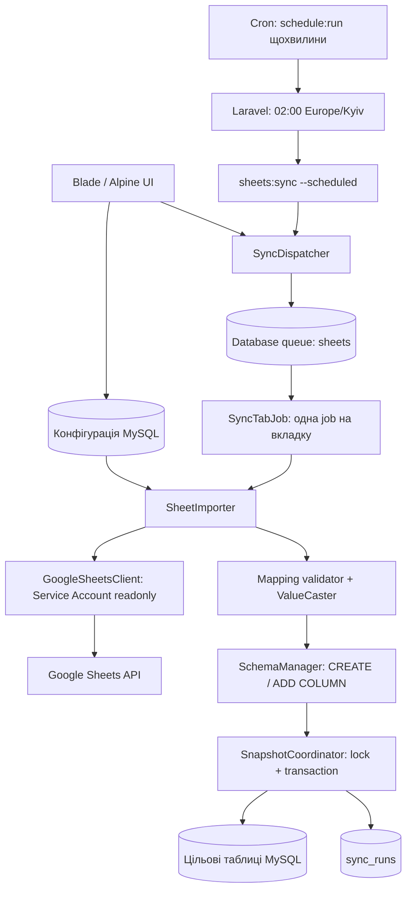
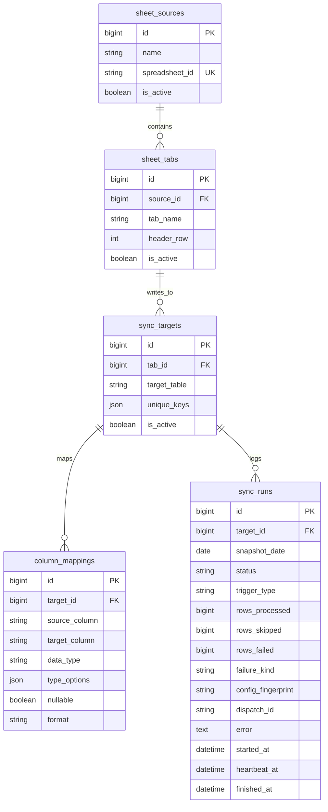
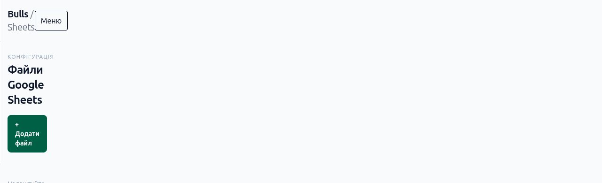
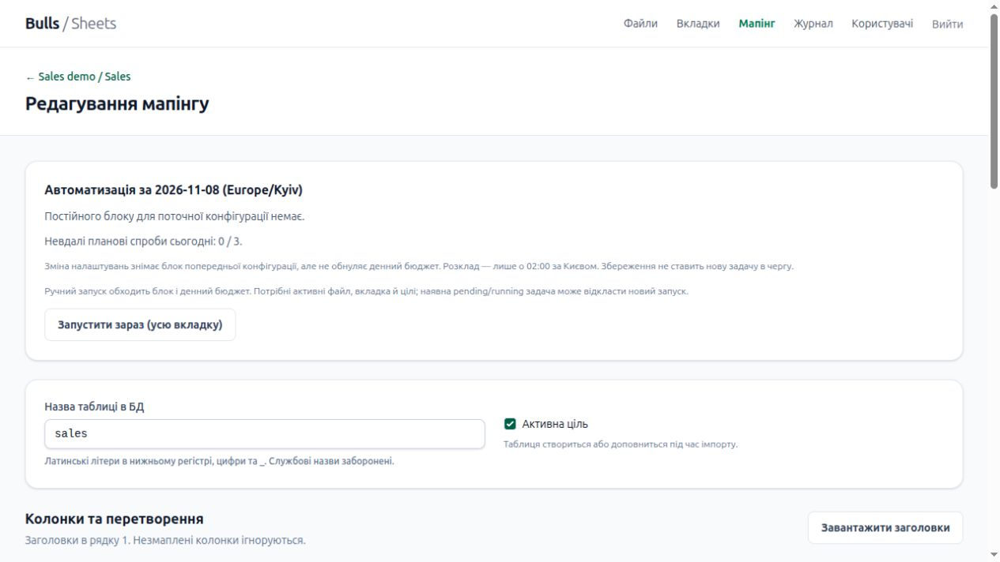
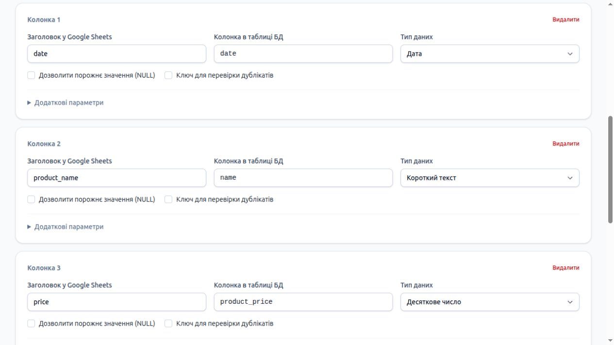

# Bulls — Google Sheets Import

Початкове середовище: Laravel 13, PHP 8.4 FPM, Nginx, MySQL 8.4.
Реалізовано схему конфігурації, Google Sheets client, SchemaManager і ядро
щоденних знімків, щоденний розклад і database-чергу. Адмінпанель Breeze / Blade / Alpine
підтримує реєстрацію зі схваленням адміністратором, конфігурацію імпорту та журнал запусків.

## Навігація

- [Архітектура](#архітектура) та [схема БД](#схема-конфігурації).
- [Google API і Service Account](#google-sheets-service-account).
- [Docker для розробки](#docker-перший-запуск-після-клонування).
- [Ubuntu setup.sh](#ubuntu-setupsh-окрема-vm-на-вашому-ноутбуці) або
  [ручне встановлення без Docker](docs/manual-installation.md).
- [Демо-seeder і mappings](#демонстраційна-конфігурація),
  [готові CSV-файли](examples/sheets/README.md), [скриншоти UI](#скриншоти-адмінпанелі).
- [Автоматизація](#автоматизація), [тести та живі перевірки](docs/testing.md).

## Архітектура



Конфігурація зберігається в БД та редагується через UI; один Service Account
читає всі дозволені йому файли. Одна job обробляє вкладку, читання спільне для
її targets. Валідація та приведення значень передують DDL; DDL виконується до
транзакції даних. MySQL GET_LOCK захищає конкретний target/date, а заміна рядків
і успішний запис журналу виконуються атомарно. Помилка target зберігає його
попередній знімок і не зупиняє інші targets. Минулі дні залишаються окремими
знімками; ручний імпорт минулого дня читає поточний стан Google, а не історію Google.

## SheetImporter: ядро імпорту

Виклик із Laravel-коду (сервіс не запускається автоматично):

```php
use App\Enums\SyncRunTriggerType;
use App\Models\SyncTarget;
use App\Services\SheetImporter;

$importer = app(SheetImporter::class);
$runs = $importer->importAll(); // Активні sources → tabs → targets, scheduled.

// Явна ручна заміна поточного або минулого дня поточними даними Google Sheets.
$run = $importer->importTarget(SyncTarget::findOrFail($targetId), '2026-11-06');
// Ручний імпорт усіх активних targets:
$runs = $importer->importAll('2026-11-06', SyncRunTriggerType::Manual);
```

Дата за замовчуванням — день старту за `Europe/Kyiv`, зафіксований один раз
для всього `importAll()`. Майбутні дати заборонені; scheduled допускає лише
поточний день. `importTarget()` за замовчуванням ручний. Всі часові позначки
журналу зберігаються в UTC. Ручний запис за минулу дату не відновлює старий
стан Google Sheets: він підставляє **поточні** дані під обрану дату знімка.

Одна вкладка може мати кілька targets. Імпортер використовує `getData()`;
targets обробляються групами за вкладкою. У межах групи кешуються успішні дані
та постійні HTTP 400/403/404 (крім quota-403); після останнього target вкладки
кеш звільняється. Помилки heartbeat, мережі та тимчасові API-помилки не кешуються. Неоднозначність
змапленого заголовка відхиляє лише відповідний target. Зайві та неіменовані
колонки ігноруються. Відсутня колонка з `nullable=true` дає `NULL` і warning
з ID target та назвою колонки; `nullable=false` дає failed навіть без рядків.
Порожні й whitespace-only клітинки стають `NULL`; обов’язкові порожні значення
відхиляють знімок. Наявна порожня optional-колонка не є попередженням.

Приведення типів:

- `string`/`text`: обрізання крайових Unicode-пробілів, збереження внутрішніх;
  перевірка довжини string і ліміту TEXT у байтах.
- `integer`: ціле в межах signed BIGINT, без обрізання дробової частини.
- `decimal`: канонічний рядок із заданим scale; зайві ненульові дробові цифри
  та переповнення precision відхиляються, автоматичного округлення немає.
  Наприклад, `12.345` зі `scale=2` є помилкою клітинки й відхиляє весь target,
  зберігаючи його попередній знімок.
  Для тексту налаштовуються `decimal_separator` і `thousands_separator`,
  наприклад `{"decimal_separator":",","thousands_separator":" "}` для `1 234,50`.
  NBSP/вузький NBSP підтримуються як пробіли при `thousands_separator=" "`.
  Числові клітинки Google уже не містять локалізованого форматування.
- `boolean`: native true/false або нормалізовані `true_values`/`false_values`;
  defaults: `1,true,yes,так` і `0,false,no,ні`. Списки не можуть перетинатися.
- `date`/`datetime`: строгий формат поля mapping **`format`**, наприклад `d.m.Y`;
  defaults `Y-m-d` / `Y-m-d H:i:s`. Неіснуючі дати й rollover відхиляються.
  `date` — календарна дата, вона **не конвертується** між поясами.
  Для `datetime` початковий пояс задається `type_options.timezone`, наприклад
  `{"timezone":"Europe/Kyiv"}`; default **UTC**. Імпортер не вгадує пояс таблиці
  й не читає `properties.timeZone`: mapping має явно відповідати налаштуванням
  джерела. Результат datetime переводиться в UTC, включно зі зміною дати.
  Явний offset/пояс у значенні та у відповідному `format` має пріоритет над mapping.
  Неіснуючий локальний час при переході DST відхиляється; для неоднозначного
  осіннього часу використовуйте явний offset у рядку й форматі.

`unique_keys=null`/`[]` дозволяє однакові бізнес-рядки. Непорожній список повинен
містити різні mapped target columns із непорожніми значеннями; комбінації
перевіряються після приведення типів, за точним значенням (без SQL collation).
Це не upsert і не додатковий SQL-індекс. `row_hash` — SHA-256 від канонічних
бізнес-значень із відсортованими ключами, без source_row/date/target; він
виявляє однаковий вміст і не використовується як унікальний ключ.

Після повної перевірки даних `SchemaManager::ensure()` створює/розширює схему
поза транзакцією. Далі одна транзакція видаляє тільки поточні target/date,
вставляє по **500 рядків** і фіксує succeeded у `sync_runs`. Помилка в будь-якому
чанку відкочує всю заміну. Успішний порожній набір видаляє попередній знімок.
Scheduled повтор після succeeded стає skipped; manual може повністю замінити
знімок, включно з видаленням зниклих рядків. Інші дні й targets зберігаються.

Для кожного target створюється окрема спроба pending → running → succeeded/
failed/skipped. Помилка одного target/табу не зупиняє наступні. `rows_processed`
рахує закомічені рядки (0 для failed/skipped). `rows_failed` — кількість
різних рядків із помилками; перевіряються всі рядки, а не лише до першого збою.
Для row-validation `error` містить JSON із `failed_rows`, `total_errors`,
першими **20 помилками клітинок** (`row`, `column`, `reason`) і `truncated`.
Значення клітинок до цього JSON не потрапляють. Помилки конфігурації/API/БД
залишаються безпечним текстом, із `rows_failed=0`. `rows_skipped=0`: порожні фізичні рядки вже пропущені
Google-клієнтом, який не повертає їх кількість.
Для UI модель `SyncRun` повертає обчислювані read-only атрибути
`rows_inserted = rows_processed` та `rows_updated = 0`, також у JSON.
Це не колонки БД: знімки не оновлюють окремі бізнес-рядки, тому дублювати
ці значення в БД не потрібно. Назва enum скрізь — `SyncRunTriggerType`.
`error` для failed/skipped
містить безпечне пояснення; рядкові значення, SQL і credentials не журналюються.

`config/sheet-import.php`: `chunk_size=500` (1–1000), `lock_timeout_seconds=0`
(0–60), `stale_after_minutes=15` (1–1440). Session advisory lock тримається для
target/date через весь імпорт. Зайнятий lock дає skipped. Pinned writer PDO
не відтворює DML на новій сесії після disconnect. Перед заміною/успіхом
перевіряється володіння lock і статус running; expired worker не може опублікувати
знімок. Під отриманим lock застарілі pending/running спроби стають failed за
останнім heartbeat, started_at або created_at. Недавня running-спроба блокує
новий імпорт до свого завершення/таймауту. Відновлення виконується при наступній
спробі цього target/date, окремого фонового reaper поки немає.
Відоме обмеження: heartbeat timeout **не звільняє GET_LOCK живого завислого
воркера**. Поки його MySQL-сесія тримає lock, нова спроба стає skipped і не
може відновити стару. HTTP-таймаути обмежують мережеві запити; зависання поза
ними (наприклад metadata lock DDL) потребує зовнішнього timeout процесу/job
і завершення сесії. Автоматичного KILL CONNECTION у застосунку немає.

Heartbeat оновлюється перед кожною спробою HTTP, включно з OAuth, після retry
очікування та під час мапінгу/запису. Стан перевіряється повторно перед commit.
Майбутній queue job, що працюватиме з раніше створеним pending ID, повинен
перевіряти статус перед стартом: API цього етапу створює нову спробу при виклику.

Обмеження: джерело, сконвертовані рядки й хеші перевірки дублікатів перебувають
у пам’яті. Чанки обмежують INSERT, але не загальне використання пам’яті.
Зміна конфігурації під час спроби відхиляє її до заміни даних:
перевіряється підпис source/tab/target/mappings до й після DDL і повторно
під блокуваннями рядків конфігурації у транзакції запису. Після зміни налаштувань
слід повторити імпорт. Живий Google smoke test виконано 2026-11-07: Service Account успішно прочитав
реальну shared-таблицю та імпортував її в окрему локальну тестову таблицю.
Автоматичні перевірки використовують fake API й ізольовану MySQL `bulls_testing`.

## SchemaManager: створення та розширення цільових таблиць

Виклик із Laravel-коду після збереження конфігурації:

```php
use App\Models\SyncTarget;
use App\Services\SchemaManager;

$target = SyncTarget::query()->findOrFail($targetId);
app(SchemaManager::class)->ensure($target);
```

`ensure()` перечитує збережений target і mappings. Незбережені зміни моделей
не застосовуються. Кожен target повинен мати хоча б один mapping.
Виклик явний: сервіс не запускається автоматично під час збереження конфігурації.
Прапорці активності перевіряє SheetImporter; SchemaManager окремо їх не фільтрує.

| `data_type` | MySQL за замовчуванням | Параметри DDL у `type_options` |
|---|---|---|
| `string` | `VARCHAR(255)` | `length`: ціле число 1–255 |
| `text` | `TEXT` | — |
| `integer` | `BIGINT` (signed) | — |
| `decimal` | `DECIMAL(15,4)` | `precision`: 1–65; `scale`: 0–30, не більше precision |
| `date` | `DATE` | — |
| `datetime` | `DATETIME` | — |
| `boolean` | `TINYINT(1)` | — |

Параметри типу передаються JSON-числами, не рядками. Опції парсингу
(`decimal_separator`, `true_values` тощо) не змінюють DDL.
Demo mapping з Етапу 1 має явні precision=12, scale=2, тому створює DECIMAL(12,2).

Нова таблиця отримує InnoDB, utf8mb4 та службові поля `id`, `sync_target_id`,
`snapshot_date`, `source_row`, `row_hash`, `created_at`, `updated_at`.
Унікальний індекс: `(sync_target_id, snapshot_date, source_row)`; повторні
бізнес-значення в різних рядках дозволені. `row_hash` — `CHAR(64)` для SHA-256.
Бізнес-колонки завжди фізично nullable, включно з mapping `nullable=false`:
так додавання поля зберігає попередні знімки. Обов’язковість значень перевіряє
імпортер для нових знімків.

Імена таблиць і колонок: `^[a-z][a-z0-9_]{0,63}$` зі строгим кінцем рядка.
Службові поля заборонені як mapping destinations. Захищені таблиці Laravel
(`users`, `migrations`, password reset/session/cache/queue tables) та префікси
`sheet_`, `sync_`, `column_mapping` не можуть бути цільовими.
Створені таблиці мають comment `bulls:sheets:snapshot:v1`. Існуючу сторонню
таблицю сервіс не приймає навіть за валідної назви; додаткові таблиці застосунку
також залишаються захищеними цим правилом. Позначка — механізм власності,
не захист від адміністратора з правами DDL.
Якщо перевіряльник вручну створить `sales`, `ensure()` її відхилить навіть
за наявності службових полів. У поточному сценарії таблицю створює сам менеджер;
наступне додавання mapping виконує ADD COLUMN відповідно до вимоги №6.
Команди `sheets:adopt-table` наразі немає; прийняття сторонніх таблиць потребує
окремої явної операції з перевіркою структури й не виконується автоматично.

Дозволені лише CREATE та ADD COLUMN. Перед змінами перевіряються всі mappings,
службова структура, primary/unique indexes та типи вже наявних mapped колонок.
Несумісність завершується `SchemaManagerException`, без автоматичних DROP,
RENAME або зміни типу. Видалення mapping не видаляє історичну колонку.
Різні targets можуть використовувати одну керовану таблицю із сумісними типами.

DDL виконується **до транзакції заміни знімка**: сервіс відхиляє виклик у відкритій
транзакції, бо MySQL може виконувати implicit commit. Зміни схеми не відкочуються
разом із даними; збій може залишити частину доданих колонок. Повторний виклик
перевіряє структуру й додає відсутні поля. MySQL `GET_LOCK` серіалізує DDL тієї
самої таблиці між workers (очікування до 10 секунд, звільнення у `finally`).
Ім’я lock — `sheets_schema:` + SHA-1 від імені БД, NUL-роздільника та таблиці:
це завжди 54 ASCII-символи, незалежно від довжини початкових імен.
Таймаут повертається як `SchemaLockTimeoutException` (нащадок
`SchemaManagerException`); черга класифікує його як retryable `schema_lock_timeout`.
Метадані та mappings читаються з writer. DDL закріплено за PDO, яке отримало
блокування: втрата сесії завершує операцію помилкою без автоматичного reconnect
і повторного DDL. Після відновлення з’єднання слід повторити весь `ensure()`.
Ручні DDL-зміни адміністратором цим блокуванням не координуються.
Потрібні права SELECT/CREATE/ALTER/INDEX у робочій БД; DROP сервіс не виконує.
Підтримується MySQL без Laravel table prefix. SQL-помилки БД повертаються як
`QueryException`; імпортер записує їх як невдалий запуск із безпечним повідомленням.
Виняток: MySQL 1118/1074 (надмірний розмір рядка/колонки) перетворюється на
`SchemaManagerException` з підказкою зменшити довжину `string` або використати `text`.
Фіксованого ліміту mappings немає: допустимий розмір залежить від типів і charset.
Навіть до транзакції імпорту ALTER може чекати metadata lock від інших довгих
транзакцій; `GET_LOCK` timeout обмежує лише advisory lock, не час виконання ALTER.

DDL-тести та тести імпортера з викликом `ensure()` мають успадковувати
`Tests\DdlDatabaseTestCase` із `DatabaseMigrations`, без транзакцій `RefreshDatabase`.
Обидві тестові бази мають спільний guard у `GuardedDatabaseTestCase`: він
перевіряє конфіг і фактичну `bulls_testing` до будь-яких міграцій.
`migrate:fresh` перед кожним DDL-тестом прибирає також динамічні таблиці.

## Google Sheets: Service Account

1. Створіть або виберіть проєкт у [Google Cloud Console](https://console.cloud.google.com/).
2. У **APIs & Services → Library** увімкніть **Google Sheets API**.
3. У **IAM & Admin → Service Accounts** створіть Service Account. Доступ до
   конкретних таблиць надається через Google Sheets; права Owner/Editor на
   Cloud-проєкт цьому акаунту для читання таблиць не потрібні.
4. Відкрийте акаунт → **Keys → Add key → Create new key → JSON** та збережіть файл.
5. Покладіть JSON у `src/storage/app/private/google-service-account.json`.
   Цей каталог уже виключений із Git. Не розміщуйте ключ у `public`.
6. У кожному Google Sheets-файлі натисніть **Share** і додайте `client_email`
   із JSON як **Viewer**. Звичайний доступ вашого Google-користувача не надає
   доступу Service Account автоматично.

Офіційні інструкції: [створення credentials](https://developers.google.com/workspace/guides/create-credentials#service-account),
[створення JSON-ключа](https://docs.cloud.google.com/iam/docs/keys-create-delete),
[Service Account OAuth](https://developers.google.com/identity/protocols/oauth2/service-account).
Якщо організація заборонила JSON-ключі або зовнішній sharing, потрібне
погоджене адміністратором налаштування доступу.

Налаштування у `src/.env` (приклад уже є в `.env.example`):

```dotenv
GOOGLE_SHEETS_CREDENTIALS=storage/app/private/google-service-account.json
GOOGLE_SHEETS_TIMEOUT=30
GOOGLE_SHEETS_CONNECT_TIMEOUT=10
GOOGLE_SHEETS_MAX_ATTEMPTS=4
```

Відносний шлях рахується від Laravel-каталогу `src`; абсолютний шлях має бути
доступним усередині PHP-контейнера. Для читання ключа CLI-користувачем та PHP-FPM:

```bash
docker compose exec php chgrp www-data storage/app/private/google-service-account.json
docker compose exec php chmod 640 storage/app/private/google-service-account.json
docker compose exec --user "$(id -u):$(id -g)" php php artisan config:clear
```

Ключ має залишатися у власності користувача, під яким виконуються CLI-команди.
OAuth access token отримується автоматично й кешується в пам’яті поточного
екземпляра клієнта до оновлення за 60 секунд перед завершенням строку дії.
Scope: `https://www.googleapis.com/auth/spreadsheets.readonly`.
Клієнт не читає ключ і не викликає Google під час запуску застосунку.

## Використання GoogleSheetsClient

У Laravel-коді або інтерактивному Tinker:

```php
use App\Services\GoogleSheets\GoogleSheetsClient;

$client = app(GoogleSheetsClient::class);
$titles = $client->getSheetTitles('SPREADSHEET_ID');

// Приклад вкладки із заголовками в третьому рядку.
$headers = $client->getHeaders('SPREADSHEET_ID', 'Sales', 3);
$rows = $client->getRows('SPREADSHEET_ID', 'Sales', 3);

foreach ($rows as $sourceRow => $values) {
    // $sourceRow — абсолютний номер рядка, наприклад 4 або 6.
    // $values — ['product_name' => 'Tea', 'price' => 0, 'amount' => null].
}
```

Передавати потрібно лише ID, не повний URL. `SPREADSHEET_ID` — частина URL між `/spreadsheets/d/` та `/edit`, а не `gid`.
`headerRow` за замовчуванням дорівнює 1. Дані читаються через `values.get`;
заголовки й рядки для `getRows()` беруться з однієї відповіді. Назви вкладок
екрануються як A1-діапазони, включно з пробілами й апострофами.

Заголовки нормалізуються: крайові Unicode-пробіли, NBSP, U+200B/U+FEFF
прибираються; внутрішні пробіли стискаються; регістр знижується через UTF-8.
`HeaderNormalizer` використовується для порівняння mappings.
Він приймає лише `string`: імпортер пропускає `null` у списку заголовків
до виклику нормалайзера. Заголовки від `getData()` вже нормалізовані.
`getHeaders()` повертає нормалізовані назви у вихідному порядку: порожні
назви стають `null`, дублікати залишаються видимими. `getData()` одним запитом
повертає `headers`, `ambiguous` (список повторних нормалізованих назв) і `rows`.
У `rows` є лише однозначні іменовані колонки; порожні, дубльовані та додаткові
колонки без заголовків ігноруються. Жоден із дублікатів не обирається довільно.
`getRows()` — скорочений доступ до `getData()['rows']` для перегляду даних;
він не призначений для імпортера, бо приховує метадані неоднозначності.
Імпортер використовує `getData()` і відхиляє target, якщо змаплена колонка
є в `ambiguous` або відсутня при `nullable=false`; відсутня optional-колонка дає NULL і warning.
Проблеми незмаплених колонок не блокують інші targets.

Короткі рядки доповнюються `null`; наявні порожні комірки `""` зберігаються.
Порожні рядки пропускаються без перенумерації, `0` та `false` зберігаються.
Вкладка лише із заголовками повертає порожні `rows`, а повністю порожня вкладка
або відсутній рядок заголовків — помилку.

Числа й boolean читаються без форматування; дати — як форматовані рядки
за налаштуваннями аркуша (`UNFORMATTED_VALUE` + `FORMATTED_STRING`).
Валюта `12.50` повертається як число без символу, а 15% — як `0.15`.
`decimal_separator` і `thousands_separator` застосовуватимуться лише до текстових
клітинок; сирі числа не потрібно повторно парсити як локалізований текст.
Дата залежить від локалі й формату клітинки: `format` має відповідати
цьому рядку. Перетворення до `data_type` виконує `ValueCaster` у ядрі імпорту.
Зараз весь аркуш і результат зіставлення зберігаються в пам’яті; streaming
і гарантії обмеженого використання пам’яті немає. Великі вкладки можуть
перевищити PHP `memory_limit`. Поділ великих файлів на діапазони
можна додати окремо, зберігши цей контракт.

## Помилки Google API та retry

Клієнт кидає `App\Exceptions\GoogleSheetsException`. `getCode()` містить
HTTP-статус або 0 для локальних помилок, невалідних відповідей чи мережевих збоїв.
Ключі, JWT, access tokens та тіла помилкових відповідей не додаються до повідомлень.

| Код | Дія |
|---|---|
| 403 `accessNotConfigured` / `SERVICE_DISABLED` | Увімкнути Sheets API у проєкті Service Account; повторів немає |
| 403, без quota-причини | Перевірити активацію Sheets API та Viewer-доступ для `client_email`; повторів немає |
| 404 | Перевірити spreadsheet ID, наявність файлу та доступ Service Account; повторів немає |
| 400 | Перевірити діапазон і тип файлу. Для `.xlsx` у режимі Office виконати File → Save as Google Sheets і використати ID створеної Google-таблиці; повторів немає |
| 401 | Перевірити Service Account credentials; повторів немає |
| 429 / quota-403 | Обмежені повтори з exponential backoff і jitter |
| 500 / 502 / 503 / 504, connection failure | Обмежені повтори; після вичерпання — виняток |

За замовчуванням — **4 спроби загалом** (1 запит + максимум 3 повтори),
затримки від 1000 ms із подвоєнням, jitter 0–1000 ms, стеля 32000 ms.
`Retry-After` у секундах або HTTP-date враховується в межах цієї стелі.
Значення понад 32 секунди за стандартних налаштувань обрізається до 32 секунд,
а не подовжує очікування понад `max_delay_ms`.
Ліміти й timeout налаштовуються у `src/config/google-sheets.php`; допустимо
1–10 спроб, connect timeout не більший за request timeout. OAuth-запити
використовують той самий транспорт. Редиректи вимкнені.
Причини 403 визначаються за машинними полями `error.status`, `errors[].reason`
та `details[].reason`, без пошуку в тексті повідомлення. Загальний HTTP 400
не доводить, що файл є Excel, тому повідомлення пропонує також перевірити запит.
Стеля 32 s працює і для `Retry-After`; за 4 стандартних спроб backoff без нього
становить 1/2/4 s плюс jitter.

Імпортер оновлює heartbeat між запитами та на кожній
спробі OAuth/Sheets (перед HTTP-викликом і після очікування retry).
Не можна оновлювати його лише після завершення всього retry-циклу.
Поточний read-only клієнт не змінює `sync_runs`.

### Перевірка абсолютних номерів рядків

Діапазон із самою назвою вкладки охоплює весь аркуш; Google документує
обрізання лише кінцевих порожніх рядків/колонок:
[ValueRange](https://developers.google.com/workspace/sheets/api/reference/rest/v4/spreadsheets.values),
[A1 notation](https://developers.google.com/workspace/sheets/api/guides/concepts#cell).
Тестова відповідь `[[], [], ["Name"], ["Tea"]]` з `headerRow=3` дає `source_row=4`.
Це перевірка контракту через fake, а не реальна відповідь Google.
Для live smoke test залишити рядки 1–2 порожніми, записати `Name` в A3 і `Tea`
в A4, додати незмаплену колонку B (`Notes` у B3, довільний текст у B4)
та перевірити `getData(ID, TAB, 3)['rows'][4]['name'] === 'Tea'`.
Також перевірити, що додаткова колонка повернулася як `notes`, а імпортер
надалі зможе її ігнорувати через mappings. Live-перевірка потребує локального JSON-ключа, ID таблиці та спільного доступу.
Вона виконана 2026-11-07 на окремому тестовому файлі: справжня відповідь API
зберегла порожні початкові рядки, дані мали source_row 4 і 6. Неіменована колонка
була проігнорована; два Total дали ambiguous=[total].
Джерело: [Google Sheets usage limits](https://developers.google.com/workspace/sheets/api/limits).

Тести інтеграції використовують згенерований тестовий RSA-ключ, HTTP-fakes
і підміну очікування; справжні ключі та мережеві запити для них не потрібні.
Перевірка конкретного живого Google-файлу потребує налаштованого ключа та sharing.

Підтверджений наскрізний smoke test у локальній `bulls`:

- `importTarget()` → succeeded, rows_processed=2; фізичні рядки джерела 4/6.
- Ціни збережено як DECIMAL `12.50` / `20.00`; optional missing mapping — NULL,
  row_hash має 64 символи SHA-256.
- Окремий target із mapping на дубльований Total → failed до CREATE TABLE;
  успішний знімок залишився цілим.
- Перевірка використовувала лише спеціальну таблицю `live_smoke_sales_2a1786a2`
  та її тестову конфігурацію. Після перевірки source/tab/targets деактивовано,
  щоб вони не потрапляли в розклад. Дані та журнал залишено для локального огляду.
- JSON-ключ і локальний `.env` виключені з Git; ключ, токени й ID приватного
  файлу до документації не включено. Google-файл не змінювався через API.


## Схема конфігурації



| Таблиця | Призначення | Унікальність |
|---|---|---|
| `sheet_sources` | Назва, Google spreadsheet ID, активність | `spreadsheet_id` |
| `sheet_tabs` | Вкладка, рядок заголовків, активність | `source_id + tab_name` |
| `sync_targets` | Цільова таблиця, опціональні бізнес-ключі, активність | `tab_id + target_table` |
| `column_mappings` | Заголовок → колонка БД, тип, опції, nullable, формат | `target_id + target_column` |
| `sync_runs` | Дата знімка, причина, статус, лічильники, помилка, час і heartbeat | Кожна спроба окрема |

Одна вкладка може мати кілька targets із незалежними mappings. Різні targets
можуть посилатися на ту саму цільову таблицю. `unique_keys=null` або `[]`
вимикає перевірку бізнес-дублікатів.

Типи колонок: `string`, `text`, `integer`, `decimal`, `boolean`, `date`,
`datetime`. `type_options` зберігається як JSON, наприклад
`{"precision":12,"scale":2}`; `format` — наприклад `Y-m-d`.
Статуси запуску: `pending`, `running`, `succeeded`, `failed`, `skipped`;
`trigger_type`: `scheduled` або `manual`. Моделі повертають enum для цих полів,
масиви для JSON, boolean для прапорців і незмінні об’єкти дат для журналу.
Час застосунку та timestamps — UTC; локальна дата знімка визначається за `Europe/Kyiv`.

Динамічні таблиці (наприклад `sales`) містять службові поля `id`,
`sync_target_id`, `snapshot_date`, `source_row`, `row_hash`, `created_at`,
`updated_at` та колонки з mappings. Унікальний індекс:
`(sync_target_id, snapshot_date, source_row)`. Зв’язок із target логічний;
фізичний FK у динамічній таблиці не створюється. `row_hash` — SHA-256,
не ключ для upsert. Поточний власник знімка — останній успішний run target/date.
Усі конфігураційні моделі також мають timestamps; у діаграмі їх опущено.

Окремо `users` зберігає адміністратора та схвалення зареєстрованих користувачів,
а стандартні `jobs`, `job_batches`, `failed_jobs`, `cache`, `cache_locks`,
`sessions` забезпечують інфраструктуру Laravel.

Конфігурація без запусків видаляється каскадно одним DELETE source.
Наявність хоча б одного запису журналу блокує видалення всього source;
для відключення використовуйте `is_active=false`. Валідацію mappings,
нормалізацію заголовків і відновлення застарілих запусків виконує імпортер.

## Демонстраційна конфігурація

Після міграцій її можна створити окремою командою:

```bash
docker compose exec --user "$(id -u):$(id -g)" php php artisan db:seed --class=SheetConfigurationSeeder
```

Seeder створює неактивне джерело `Sales demo` з placeholder
`REPLACE_WITH_SPREADSHEET_ID`, вкладку `Sales` і target `sales`:

| Google Sheets | Колонка БД | Тип |
|---|---|---|
| `date` | `date` | date, `Y-m-d` |
| `product_name` | `name` | string, довжина 255 |
| `price` | `product_price` | decimal(12,2) |
| `amount` | `amount` | integer |

У прикладі `unique_keys=null`; усі чотири mappings обов’язкові для
імпорту. Seeder можна виконувати повторно: наявні записи не дублюються й
не перезаписуються. Він не викликає Google API та не створює таблицю `sales`.
`DatabaseSeeder` не запускає цей приклад автоматично.

Для Ubuntu після встановлення:

```bash
sudo -u bulls /usr/bin/php8.4 /var/www/bulls/src/artisan db:seed --class=SheetConfigurationSeeder --force
```

Готові синтетичні файли: [sales.csv](examples/sheets/sales.csv) і
[sales-reordered.csv](examples/sheets/sales-reordered.csv). Другий містить ті самі
продажі з іншим порядком колонок та додатковою notes.
[Інструкція імпорту CSV в Google і підключення демо](examples/sheets/README.md).
Замініть placeholder на ID власного файлу, надайте Viewer Service Account
і лише потім активуйте джерело. Відразу після seed Google API не викликається.

## Скриншоти адмінпанелі

Справжня Ubuntu 24.04 VM із демо-seeder; персональні дані не включено.
Джерело неактивне, тому демонстрація не запускає імпорт placeholder-файлу.

Список джерел:



Цільова таблиця та стан автоматизації:



Відповідність заголовків колонкам БД:



## Вимоги

Для Docker-варіанта: Linux із Docker Engine та Docker Compose v2.
Локальні PHP і Composer не потрібні.
Команди виконуйте з кореня проєкту.

## Docker: перший запуск після клонування

```bash
docker compose build php
cp src/.env.example src/.env
docker compose run --rm --no-deps --user "$(id -u):$(id -g)" -e COMPOSER_HOME=/tmp/composer php composer install --no-interaction
docker compose run --rm --no-deps --user "$(id -u):$(id -g)" php php artisan key:generate
docker compose up -d
docker compose exec --user "$(id -u):$(id -g)" php php artisan migrate
```

PHP-FPM працює як `www-data`. Дайте контейнеру доступ до каталогів Laravel:

```bash
docker compose exec php chgrp -R www-data storage bootstrap/cache
docker compose exec php chmod -R g+rwX storage bootstrap/cache
```

Застосунок: http://localhost:8082.

## База даних

Laravel у контейнері підключається до `mysql:3306`.
Для клієнта на хостовій машині: `127.0.0.1:3307`.
База та користувач: `bulls`, пароль: `secret` (лише локальна розробка).
Налаштування Laravel зберігаються у `src/.env`; шаблон — `src/.env.example`.
Не додавайте `.env` до Git.

## Повсякденні команди

```bash
docker compose up -d
docker compose ps
docker compose exec --user "$(id -u):$(id -g)" php php artisan migrate
docker compose exec --user "$(id -u):$(id -g)" php php artisan test
docker compose exec --user "$(id -u):$(id -g)" -e COMPOSER_HOME=/tmp/composer php composer install
docker compose logs -f php nginx
docker compose down
```

`docker compose down` зберігає дані MySQL у Docker volume.
Опція `down -v` видаляє також базу даних.

## MySQL-тести

Для перевірок БД використовується окрема база `bulls_testing`. Створіть її
один раз після запуску MySQL; команду можна виконувати повторно:

```bash
docker compose exec -T mysql sh -c 'MYSQL_PWD="$MYSQL_ROOT_PASSWORD" exec mysql -uroot' <<'SQL'
CREATE DATABASE IF NOT EXISTS bulls_testing CHARACTER SET utf8mb4 COLLATE utf8mb4_unicode_ci;
GRANT ALL PRIVILEGES ON bulls_testing.* TO 'bulls'@'%';
SQL
```

Запуск двох незалежних наборів тестів:

```bash
docker compose exec --user "$(id -u):$(id -g)" php php artisan config:clear
docker compose exec --user "$(id -u):$(id -g)" php php artisan test
docker compose exec --user "$(id -u):$(id -g)" php vendor/bin/phpunit --configuration=phpunit.mysql.xml
```

`phpunit.xml` виключає MySQL-тести; `phpunit.mysql.xml` є окремою копією
конфігурації лише для `tests/Feature/Database`. Спільні налаштування слід
підтримувати в обох файлах. Для окремого конфігу використовується прямий
запуск PHPUnit: встановлена версія `artisan test` сама додає `--configuration`,
і додатковий такий параметр спричиняє попередження й ненульовий код виходу.

Звичайні тести БД наслідують `Tests\DatabaseTestCase`. Перед
`RefreshDatabase` він відхиляє конфіг-кеш, непорожній `DB_URL`, інший драйвер
або іншу назву БД; також перевіряє фактичну базу записувального підключення.
Після перевірки `RefreshDatabase` може очистити й перебудувати **лише
`bulls_testing`**. У тестах із некоректною конфігурацією використовується
перевірочний клас, який додатково зупиняє виконання перед міграціями,
навіть якщо захист зламається.

MySQL-конфіг примусово задає DB-змінні в `env` і `server`, щоб перекрити
значення середовища контейнера. Основна база `bulls` залишається окремою.

## Xdebug / PhpStorm

Xdebug встановлений, але за замовчуванням вимкнений.

```bash
XDEBUG_MODE=debug,profile docker compose up -d php
```

PhpStorm server: `bulls`, port: `9003`, mapping: `src` → `/var/www/html`.
Налагодження й профілювання запускаються через `XDEBUG_TRIGGER`.
Файли профілювання: `/tmp/xdebug` усередині PHP-контейнера.

## Frontend

Для адмінпанелі потрібна збірка Vite / Tailwind / Alpine. Використовуйте Node.js
22.12+ (або сумісну новішу версію) та npm на хості; PHP-контейнер не містить Node.js.
З кореня репозиторію:

```bash
cd src
npm ci --ignore-scripts
npm run build
```

Зібрані файли створюються в `src/public/build`; вони не зберігаються в Git.
Для розробки доступний `npm run dev`. Шрифти системні, збірка не завантажує їх із зовнішніх сервісів.

## Адмінпанель: перший запуск

Після встановлення Composer-залежностей і збірки frontend додайте в локальний
`src/.env` власні `ADMIN_NAME`, `ADMIN_EMAIL`, `ADMIN_PASSWORD` (щонайменше 12 символів).
Готового пароля немає; не додавайте `.env` у Git. З кореня репозиторію:

```bash
docker compose exec --user 1000:1000 php php artisan config:clear
docker compose exec --user 1000:1000 php php artisan migrate --no-interaction
docker compose exec --user 1000:1000 php php artisan db:seed --class=AdminSeeder
```

Міграція додає `is_admin`, `approved_at`, `approved_by` до `users`. Seeder створює
одного вже схваленого адміністратора. Повторний запуск з тим самим email зберігає
пароль; інший email адміністратора та email уже зареєстрованого звичайного
користувача відхиляються. Це захищає від захоплення адміністративного доступу
через попередню реєстрацію. Після створення можна прибрати `ADMIN_PASSWORD` із `.env`.
Не використовуйте `migrate:fresh` для робочої бази.

Відкрийте [вхід](http://localhost:8082/login). Публічна
[реєстрація](http://localhost:8082/register) створює користувача без доступу до
панелі: він бачить сторінку очікування. Адміністратор схвалює його в розділі
«Користувачі». Відкликання доступу блокує наступний запит навіть у відкритій
сесії, але не скасовує вже поставлені системні задачі.
**Усі схвалені користувачі працюють зі спільними файлами, мапінгами та журналом.**
Керування користувачами доступне лише адміністратору. Немає окремих робочих
просторів, повідомлень про схвалення, відновлення пароля чи керування профілем.

Послідовність налаштування:

1. «Файли» → «Додати файл»: назва, Google Sheets URL або ID, активність.
   «Перевірити доступ» звертається до Google лише після натискання.
2. У файлі натисніть «Завантажити вкладки» або додайте вкладку вручну.
   Нові завантажені вкладки неактивні; задайте точну назву, рядок заголовків та активність.
3. У вкладці створіть одну чи кілька цілей і задайте назву таблиці БД.
   «Завантажити заголовки» пропонує лише однозначні заголовки.
   Для кожної колонки вкажіть відповідність, тип, NULL і за потреби ключ.
   Ключ перевіряє дублікати; знімки залишаються щоденними, без upsert.
4. У «Додаткових параметрах» налаштуйте формат дати та JSON параметрів типу,
   наприклад `{"precision":12,"scale":2}` або `{"timezone":"Europe/Kyiv"}`.
   Для datetime типовий початковий пояс UTC. Правила приведення типів описано вище.
5. Збереження конфігурації не створює таблиць. Вони створюються/доповнюються
   під час імпорту. При одночасному редагуванні застарілий мапінг відхиляється;
   оновіть сторінку, щоб побачити останні налаштування.
6. «Запустити зараз» ставить ручну задачу на вкладку в чергу. Потрібен запущений
   воркер (див. «Автоматизація»). Дата може бути сьогоднішня або минула;
   для минулої дати все одно читається поточний стан Google Sheets.
7. «Запуски» містить фільтри, сторінки журналу й деталі помилок. Час журналу
   показано в UTC, дата знімка відповідає календарному дню за Києвом.

Конфігурація з історією лише деактивується; чисту можна видалити. Видалення
конфігурації чи колонки мапінгу не видаляє таблиці/дані призначення. Перегляд
самих цільових даних та очищення журналу в цей етап не входять.

Для Google-кнопок файл Service Account повинен читатися **і PHP-FPM, і воркером**.
Режим `0600` придатний лише коли вони працюють від власника ключа. Якщо FPM та CLI
мають різні UID, налаштуйте спільну групу, читання `0640` і доступ до батьківських
каталогів; не робіть ключ загальнодоступним і не розміщуйте його в `public/`.
Доступ Viewer до Google-таблиці надається email Service Account, як описано
в інструкції Google API. У розробці тести використовують підміну API, без реальних запитів.

Для Docker міграції, створення адміністратора та запуск воркерів виконуються
наведеними командами. Ubuntu `setup.sh` виконує ці кроки автоматично.

## Стан автоматизації та обмеження UI

На сторінці мапінгу показано постійний блок для **поточного** fingerprint і
кількість невдалих scheduled-спроб за сьогоднішню дату Europe/Kyiv (ліміт 3).
Зміна мапінгу знімає блок попередньої конфігурації, але **не скидає денний бюджет**.
Успішний ручний запуск знімає відповідний постійний блок, але теж не обнуляє
лічильник невдач. «Запустити зараз (усю вкладку)» веде до ручного запуску, який
обходить обидва обмеження; активність конфігурації та pending/running перевіряються
як раніше. Збереження форми не запускає імпорт; розклад залишається лише о 02:00.

Журнал і сторінка мапінгу попереджають про pending без активності довше за
`sheet-import.stale_after_minutes` (типово 15 хвилин): перевірте воркер.
Це read-only індикатор, він не змінює статусів. Expired — це `status=failed`
із `failure_kind=expired`, що встановлюється під час відновлення спроби,
а не окремий статус чи автоматична дія сторінки. Такі scheduled-невдачі
витрачають денний бюджет, manual-невдачі — ні.

Усі Google helpers (перевірка доступу, вкладки, заголовки) мають **один спільний
ліміт 6 дій/хвилину** для всіх користувачів і файлів, із HTTP 429 після ліміту.
Для кількох PHP-процесів потрібен спільний cache store (`CACHE_STORE=database`,
як у прикладі); `array` і локальний файловий кеш між серверами не підходять.
Це обмеження UI-дій, а не гарантія всіх API-квот: retries теж роблять запити,
а імпортер має окремий backoff. Зберігайте одного воркера, як описано нижче.

Редактор приймає `type_options` до **10000 байтів**, із обмеженням глибини JSON 4.
Дозволені лише `precision`, `scale`, `length`, `timezone`, `decimal_separator`,
`thousands_separator`, `true_values`, `false_values`; лише останні два можуть
бути плоскими списками рядків. Значення додатково перевіряє ValueCaster.
Перейменування destination-колонки не є SQL RENAME: наступний імпорт додасть
нову фізичну колонку, стара залишиться, старі знімки матимуть NULL у новій колонці.

**Обмеження:** UI не виконує попередню перевірку типів спільної фізичної таблиці
через INFORMATION_SCHEMA. Якщо targets описують ту саму таблицю/колонку різними
типами чи параметрами, SchemaManager відхилить конфлікт під час імпорту.
Узгоджуйте ці mappings між targets; зміна типу у формі не виконує ALTER існуючого
типу. ImportConfigurationValidator залишається остаточною перевіркою заголовків
і даних під час імпорту. Збереження UI не звертається до Google і не виконує DDL.

## Продакшен: HTTPS і сесії

У production використовуйте HTTPS і задайте в `.env`:

```dotenv
APP_ENV=production
APP_DEBUG=false
APP_URL=https://your-domain.example
SESSION_SECURE_COOKIE=true
SESSION_HTTP_ONLY=true
SESSION_SAME_SITE=lax
CACHE_STORE=database
```

Після зміни очистьте/перебудуйте конфіг-кеш у вашому процесі розгортання.
Панель додає `X-Content-Type-Options: nosniff`, `X-Frame-Options: DENY`,
`Referrer-Policy: strict-origin-when-cross-origin` і заборону camera/microphone/
geolocation через `Permissions-Policy`. HSTS задавайте на HTTPS-віртуальному
хості reverse proxy, наприклад `Strict-Transport-Security: max-age=31536000`,
після перевірки коректної роботи TLS. Для локального HTTP Secure-cookie має
залишатися вимкненим. Якщо TLS завершується на проксі, налаштуйте довіру лише
до своїх проксі, щоб Laravel коректно визначав HTTPS. Суворий CSP потребує
окремого узгодження з Alpine/Vite; готової CSP-політики цей етап не додає.

## Автоматизація

Використовується MySQL-черга `database`, одна `SyncTabJob` на вкладку й один
воркер. Команда **ставить задачі в чергу**, а не чекає завершення імпорту.
`--source` і `--tab` — числові ID записів конфігурації, не Google ID/назва вкладки.

Спочатку застосуйте нову міграцію метаданих `sync_runs`:

```bash
docker compose exec --user 1000:1000 php php artisan migrate --no-interaction
docker compose exec --user 1000:1000 php php artisan config:clear
```

Ручні запуски:

```bash
docker compose exec --user 1000:1000 php php artisan sheets:sync
docker compose exec --user 1000:1000 php php artisan sheets:sync --source=1 --tab=2
docker compose exec --user 1000:1000 php php artisan sheets:sync --source=1 --date=2026-11-06
```

`--date` приймає поточну або минулу дату; читається поточний стан Google Sheets.
Ручна команда обходить scheduled-бюджет і постійне блокування, але поважає
активність конфігурації, pending/running та snapshot lock. Наявна pending/running
робота не дублюється. Ручний успіх із поточним fingerprint знімає попереднє
постійне блокування, не видаляючи історію та не обнуляючи денний лічильник.

Узгоджений розклад — **лише раз на добу о 02:00 Europe/Kyiv**, без півгодинних
повторів. `sheets:sync --scheduled` відбирає активні targets без succeeded за
сьогодні (manual-успіх теж рахується), pending/running роботи, вичерпаного бюджету
чи постійного блокування. Умови повторно перевіряються під lock при доставці.
Після півночі scheduled-задача за попередню дату пропускається без читання Sheets;
історичні прогалини автоматично не заповнюються.

Одна job ділить кеш читання між targets вкладки. `tries=3`, backoff 60/180 с:
queue-повтори призначені для schema-lock timeout та зайнятого snapshot lock.
Успішні siblings повторно не імпортуються. Для scheduled діє межа **3 failed-спроби
на target/date**, включно з queue retries, незалежно від зміни конфігурації.
Інші тимчасові помилки повторюються лише наступним плановим або явним запуском.

**Обмеження щоденного запуску:** якщо Google недоступний о 02:00 і внутрішні
HTTP-повтори вичерпані, автоматичної спроби пізніше того самого дня не буде.
Знімок за цей день може бути відсутній до ручного відновлення; наступний
щоденний запуск обробляє вже нову дату. Наприклад, для пропущеного 7 листопада:

```bash
# Docker: поставити відновлення в чергу; worker має працювати
docker compose exec --user 1000:1000 php php artisan sheets:sync --source=1 --date=2026-11-07

# Ubuntu: виконати з каталогу Laravel; Supervisor worker має працювати
php artisan sheets:sync --source=1 --date=2026-11-07
```

Замініть ID джерела й дату на потрібні; за необхідності додайте `--tab=2`.
Відновлення читає **поточний** стан Sheets і записує його під указаною датою,
а не відтворює історичний стан таблиці на ту дату. Додаткового запуску о 06:00
в погодженому розкладі немає.

Постійні помилки mapping/schema та non-retryable API 400/401/403/404 блокують
scheduled-запуски для того самого fingerprint і після опівночі. Quota 403,
помилки рядків, timeout та невідомі збої не створюють постійного блокування.
Виправлення доступу в Google не змінює fingerprint: після нього виконайте ручний
імпорт. Класифікація, fingerprint і dispatch UUID зберігаються в `sync_runs`;
значення клітинок і ключі доступу туди не потрапляють.

Резервування pending передує enqueue. Помилка enqueue закриває зарезервовані
спроби як failed; аварія між цими діями може залишити pending до відновлення.
Outbox немає: commit резервування та enqueue не є однією атомарною операцією.
Після таймауту такий pending закривається як failed під час наступного
dispatch/доставки; scheduled-невдача витрачає денний бюджет відповідного
target/date, навіть якщо запит до Google ще не виконувався.
Pending старше 15 хвилин закриваються під вільним snapshot lock. Покинутий
`running`, що вже не має власника lock, завершується без повторного запису даних
при наступному dispatch/доставці, включно з попередніми датами. Завершені та прострочені run IDs не виконуються
знову. Live lock-holder потребує завершення процесу/сесії; application не
виконує database KILL. Retention журналу залишається окремою задачею.

### Docker automation

Звичайний `docker compose up` запускає середовище розробки без автоматизації.
Для автоматизації оберіть один спосіб: Docker worker + scheduler із цього
розділу або Ubuntu Supervisor + cron із наступного. Не запускайте обидві
пари одночасно для тієї самої бази й черги.

Docker-автоматизація вмикається явно:

```bash
docker compose -f docker-compose.yml -f docker-compose.automation.yml up -d worker scheduler
docker compose -f docker-compose.yml -f docker-compose.automation.yml logs worker scheduler
```

### Ubuntu: cron та Supervisor

```cron
* * * * * bulls /bin/sh -c 'umask 0002; cd /var/www/bulls/src && /usr/bin/flock -n storage/framework/schedule-run.lock /usr/bin/php8.4 artisan schedule:run >> storage/logs/scheduler.log 2>&1'
```

Перевірте шляхи й користувача в [Supervisor-конфігу](deploy/supervisor-sheets.conf),
скопіюйте його до `/etc/supervisor/conf.d/bulls-sheets.conf` та застосуйте:

```bash
sudo supervisorctl reread
sudo supervisorctl update
sudo supervisorctl status bulls-sheets-worker
```

Конфіг використовує [обгортку воркера](deploy/queue-worker.sh), `numprocs=1`,
`stopasgroup=true`, `killasgroup=true`, `stopwaitsecs=660`. `setup.sh`
генерує такий самий ліміт з явним `/usr/bin/php8.4`. Не запускайте Docker worker і Supervisor worker
одночасно для цієї черги. Один воркер не гарантує дотримання квоти сам по собі:
HTTP retry/backoff залишається потрібним. Redis у цьому варіанті не налаштований.

### Таймаути й перевірки

Job timeout — 600 с. Зовнішня обгортка запускає один `queue:work --once` під
GNU `timeout`: TERM через 615 с, KILL ще через 15 с, жорстка межа 630 с.
Database `retry_after=720` перевищує цю межу й стосується **однієї спроби**.
Під час backoff job звільняє резервування й чекає майбутнього `available_at`;
воркер не спить всередині зарезервованої job. Вкладка повинна вміщатися в ліміт
job; timeout не перетворює частково виконаний target на успішний знімок.
При зміні env переконайтеся, що config cache не містить старого retry_after.

Автоматичні тести перевіряють metadata/policy, кеш, доставки, прострочення,
справжню database-чергу та нерівності таймаутів без тривалих очікувань.
TERM/KILL заблокованого disposable worker — окрема ручна перевірка поза CI
у [чеклісті](docs/superpowers/plans/2026-11-07-scheduling-followups.md), лише на
тестовій базі.

Перегляд розкладу без імпорту:

```bash
docker compose exec --user 1000:1000 php php artisan schedule:list
```


## Ubuntu setup.sh: окрема VM на вашому ноутбуці

Швидкий варіант на чистій Ubuntu 22.04/24.04 із checkout у `/var/www/bulls`:

```bash
cd /var/www/bulls
sudo ./setup.sh --server-name YOUR_VM_IP
```

Скрипт запитає дані адміністратора; готового пароля немає. Для встановлення
без скрипта дивіться [повну ручну інструкцію](docs/manual-installation.md).

Мінімальний [setup.sh](setup.sh) підтримує **Ubuntu 22.04 і 24.04 LTS** зі
запущеним systemd, на чистій виділеній VM. Не запускайте його на основній ОС
ноутбука: він встановлює системні служби й керує `/var/www/bulls`, БД `bulls`,
MySQL-акаунтом `bulls_app` і системним користувачем `bulls`.
Plain Docker або WSL без systemd не підходять для цієї перевірки.

Скрипт встановлює PHP 8.4 (фактичний lock потребує **>=8.4.1**), PHP-розширення,
nginx, MySQL 8.0 із Ubuntu, Supervisor/cron, Composer2 і **Node.js 22 >=22.12**.
PHP отримується з додаткового `ondrej/php` PPA; потрібен доступ до Launchpad.
Composer installer і офіційний Node-архів перевіряються за checksum через HTTPS.
Node залишається потрібним для production-збірки Vite; `public/build` не додається
до Git. Composer/npm/Artisan виконуються як `bulls`, не як root.

Це bootstrap одного checkout і його повторний запуск у простої, **не механізм
оновлення працюючого сайту**. rsync, maintenance/release-процес і фазові маркери
відкладено до реальної VM-перевірки. Не запускайте імпорти чи користувацькі запити
під час повторного setup. Не поєднуйте цю автоматизацію з Docker worker/scheduler.

### Створення тестової VM

На ноутбуці можна використати [Multipass від Canonical](https://canonical.com/multipass/docs/latest/how-to-guides/install-multipass/).
Команди нижче створюють окрему VM, а не встановлюють стек застосунку на хості:

```bash
sudo snap install multipass
multipass launch 24.04 --name bulls-setup --cpus 2 --memory 4G --disk 20G
multipass info bulls-setup
```

Для повторення на 22.04 використайте іншу чисту VM та ім’я, наприклад `bulls-setup22`.
Віртуалізація має бути доступна в BIOS/UEFI; проблеми запуску VM усуваються до setup.

У VM потрібна поточна версія файлів, включно з ще не закоміченим `setup.sh`.
Можна клонувати вже опублікований репозиторій у `/var/www/bulls`, або передати
локальні вихідні файли без `.env`, ключів та runtime-даних. З кореня цього проєкту
на ноутбуці. Environment-файли виключено всі, після чого додається лише публічний `.env.example`:

```bash
tar --exclude='src/.env*' \
  --exclude='src/vendor' --exclude='src/node_modules' --exclude='src/storage' \
  --exclude='src/bootstrap/cache' --exclude='src/public/storage' \
  --exclude='src/public/build' --exclude='src/public/hot' \
  --exclude='src/.git' --exclude='src/.codex' --exclude='src/.idea' \
  -cf /tmp/bulls-ubuntu-source.tar setup.sh deploy src examples
tar -rf /tmp/bulls-ubuntu-source.tar src/.env.example
gzip -f /tmp/bulls-ubuntu-source.tar
multipass transfer /tmp/bulls-ubuntu-source.tar.gz bulls-setup:/home/ubuntu/
multipass shell bulls-setup
```

Далі **всередині VM**:

```bash
sudo install -d -m 0755 /var/www/bulls
sudo tar --no-same-owner -xzf /home/ubuntu/bulls-ubuntu-source.tar.gz -C /var/www/bulls
cd /var/www/bulls
vm_host=$(hostname -I | awk '{print $1}')
printf 'Test URL: http://%s/login\n' "$vm_host"
sudo script -q -e -c "./setup.sh --server-name $vm_host" /root/bulls-setup-run1.log
```

Скрипт запитає власні email, ім’я та прихований пароль адміністратора
(щонайменше 12 символів, максимум 72 байти). Не передавайте пароль аргументом команди,
не вмикайте shell tracing або запис input-потоку термінала. `script` тут записує
вивід, а не прихований пароль. Після setup `curl "http://$vm_host/up"` у VM має
повернути 200. Відкрийте в браузері ноутбука URL із `Test URL` вище. Переконайтеся,
що `vm_host` відповідає IPv4 із `multipass info`; для обох запусків значення має
бути однаковим. TLS скрипт не видає; HTTPS налаштовується окремо.

Після асинхронного reload nginx перевірка `/up` повторює невдалі запити
до 5 разів із паузою 1 секунду та обмеженням часу. Успіхом є лише HTTP 200;
стала помилка зупиняє setup і залишає керовану автоматизацію вимкненою.

Повторний запуск із тим самим server name та admin email:

```bash
sudo script -q -e -c "./setup.sh --server-name $vm_host" /root/bulls-setup-run2.log
```

Якщо адміністратор уже створений, пароль можна залишити порожнім: seeder збереже
наявний hash. APP_KEY і випадковий пароль БД не перегенеровуються. Власні значення
керованого `.env` зберігаються; чужий `.env`/БД/DB-користувач не приймаються автоматично.
Перший bootstrap додає службовий коментар у `.env`, наступний розпізнає його.
Це простий маркер того самого встановлення, не гарантія відновлення після будь-якого збою.

Для noninteractive-запуску доступний `--admin-file /root/bulls-admin.json`.
Створіть root-owned JSON із режимом 0600 JSON з рядковими ключами `email`, `name`, `password` через
редактор, без секретів у shell history. Файл парситься як дані, не виконується.
Пароль записується тимчасово в `.env`, після seed видаляється в finally, і лише
потім виконується `config:cache`; наявність bootstrap-пароля в кеші завершує setup
помилкою й видаленням небезпечного кешу. Input JSON залишається під вашим контролем.

Єдиний типовий шлях Google-ключа для Docker та Ubuntu:
`/var/www/bulls/src/storage/app/private/google-service-account.json` (відносно Laravel:
`storage/app/private/google-service-account.json`). Після локального копіювання JSON:

```bash
sudo chown bulls:www-data /var/www/bulls/src/storage/app/private/google-service-account.json
sudo chmod 0640 /var/www/bulls/src/storage/app/private/google-service-account.json
```

Секрети не слід включати до архіву вихідного коду чи передавати в чат. Надайте
Service Account доступ Viewer до тестової Google-таблиці. Без ключа звичайний вхід
і CRUD працюють, а Google-перевірки та імпорт потребують налаштованих credentials.

### Окрема сумісність MySQL 8.0

[Compose-файл для MySQL 8.0](docker-compose.mysql80-test.yml) створює окремий проєкт,
мережу й том, без опублікованих портів. Це тест БД, **не заміна Ubuntu VM**:

```bash
docker compose -f docker-compose.mysql80-test.yml up -d --build
docker compose -f docker-compose.mysql80-test.yml exec --user 1000:1000 php \
  vendor/bin/phpunit --configuration=phpunit.mysql.xml
```

Видалення лише одноразового стенду та його **тестових** даних:

```bash
docker compose -f docker-compose.mysql80-test.yml down -v
```
