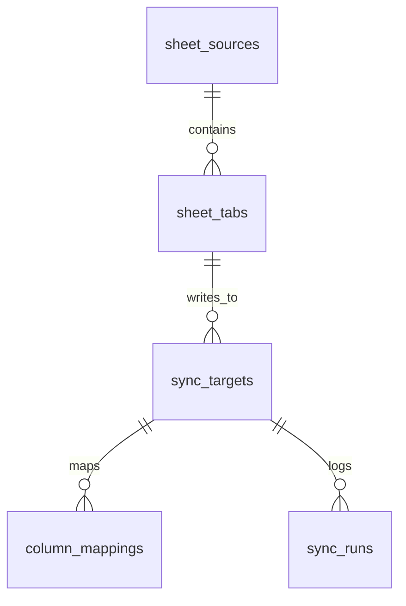

# Bulls — Google Sheets Import

Початкове середовище: Laravel 13, PHP 8.4 FPM, Nginx, MySQL 8.4.
Імпорт Google Sheets і щоденний розклад ще не реалізовані.

## Схема конфігурації



| Таблиця | Призначення | Унікальність |
|---|---|---|
| `sheet_sources` | Назва, Google spreadsheet ID, активність | `spreadsheet_id` |
| `sheet_tabs` | Вкладка, рядок заголовків, активність | `source_id + tab_name` |
| `sync_targets` | Цільова таблиця, опціональні бізнес-ключі, активність | `tab_id + target_table` |
| `column_mappings` | Заголовок → колонка БД, тип, опції, nullable, формат | `target_id + target_column` |
| `sync_runs` | Дата знімка, причина, статус, лічильники, помилка, час і heartbeat | Кожна спроба окрема |

Одна вкладка може мати кілька targets із незалежними mappings. Різні targets
можуть посилатися на ту саму цільову таблицю. `unique_keys=null` або `[]`
вимикає майбутню перевірку бізнес-дублікатів.

Типи колонок: `string`, `text`, `integer`, `decimal`, `boolean`, `date`,
`datetime`. `type_options` зберігається як JSON, наприклад
`{"precision":12,"scale":2}`; `format` — наприклад `Y-m-d`.
Статуси запуску: `pending`, `running`, `succeeded`, `failed`, `skipped`;
`trigger_type`: `scheduled` або `manual`. Моделі повертають enum для цих полів,
масиви для JSON, boolean для прапорців і незмінні об’єкти дат для журналу.
Час застосунку та timestamps — UTC; локальна дата майбутнього знімка
визначатиметься окремо за `Europe/Kyiv`.

Конфігурація без запусків видаляється каскадно одним DELETE source.
Наявність хоча б одного запису журналу блокує видалення всього source;
для відключення використовуйте `is_active=false`. Валідація вхідних даних,
нормалізація заголовків і відновлення завислих запусків належать етапу імпортера.

## Демонстраційна конфігурація

Після міграцій її можна створити окремою командою:

```bash
docker compose exec --user "$(id -u):$(id -g)" php php artisan db:seed --class=SheetConfigurationSeeder
```

Seeder створює неактивне джерело `Sales demo` з placeholder
`REPLACE_WITH_SPREADSHEET_ID`, вкладку `Sales` і target `sales`:

| Google Sheets | Колонка БД | Тип |
|---|---|---|
| `date` | `date` | date, `Y-m-d` |
| `product_name` | `name` | string, довжина 255 |
| `price` | `product_price` | decimal(12,2) |
| `amount` | `amount` | integer |

У прикладі `unique_keys=null`; усі чотири mappings обов’язкові для майбутнього
імпорту. Seeder можна виконувати повторно: наявні записи не дублюються й
не перезаписуються. Він не викликає Google API та не створює таблицю `sales`.
`DatabaseSeeder` не запускає цей приклад автоматично.

## Вимоги

Linux із Docker Engine та Docker Compose v2. Локальні PHP і Composer не потрібні.
Команди виконуйте з кореня проєкту.

## Docker: перший запуск після клонування

```bash
docker compose build php
cp src/.env.example src/.env
docker compose run --rm --no-deps --user "$(id -u):$(id -g)" -e COMPOSER_HOME=/tmp/composer php composer install --no-interaction
docker compose run --rm --no-deps --user "$(id -u):$(id -g)" php php artisan key:generate
docker compose up -d
docker compose exec --user "$(id -u):$(id -g)" php php artisan migrate
```

PHP-FPM працює як `www-data`. Дайте контейнеру доступ до каталогів Laravel:

```bash
docker compose exec php chgrp -R www-data storage bootstrap/cache
docker compose exec php chmod -R g+rwX storage bootstrap/cache
```

Застосунок: http://localhost:8082.

## База даних

Laravel у контейнері підключається до `mysql:3306`.
Для клієнта на хостовій машині: `127.0.0.1:3307`.
База та користувач: `bulls`, пароль: `secret` (лише локальна розробка).
Налаштування Laravel зберігаються у `src/.env`; шаблон — `src/.env.example`.
Не додавайте `.env` до Git.

## Повсякденні команди

```bash
docker compose up -d
docker compose ps
docker compose exec --user "$(id -u):$(id -g)" php php artisan migrate
docker compose exec --user "$(id -u):$(id -g)" php php artisan test
docker compose exec --user "$(id -u):$(id -g)" -e COMPOSER_HOME=/tmp/composer php composer install
docker compose logs -f php nginx
docker compose down
```

`docker compose down` зберігає дані MySQL у Docker volume.
Опція `down -v` видаляє також базу даних.

## MySQL-тести

Для перевірок БД використовується окрема база `bulls_testing`. Створіть її
один раз після запуску MySQL; команду можна виконувати повторно:

```bash
docker compose exec -T mysql sh -c 'MYSQL_PWD="$MYSQL_ROOT_PASSWORD" exec mysql -uroot' <<'SQL'
CREATE DATABASE IF NOT EXISTS bulls_testing CHARACTER SET utf8mb4 COLLATE utf8mb4_unicode_ci;
GRANT ALL PRIVILEGES ON bulls_testing.* TO 'bulls'@'%';
SQL
```

Запуск двох незалежних наборів тестів:

```bash
docker compose exec --user "$(id -u):$(id -g)" php php artisan config:clear
docker compose exec --user "$(id -u):$(id -g)" php php artisan test
docker compose exec --user "$(id -u):$(id -g)" php vendor/bin/phpunit --configuration=phpunit.mysql.xml
```

`phpunit.xml` виключає MySQL-тести; `phpunit.mysql.xml` є окремою копією
конфігурації лише для `tests/Feature/Database`. Спільні налаштування слід
підтримувати в обох файлах. Для окремого конфігу використовується прямий
запуск PHPUnit: встановлена версія `artisan test` сама додає `--configuration`,
і додатковий такий параметр спричиняє попередження й ненульовий код виходу.

Майбутні тести схеми мають наслідувати `Tests\DatabaseTestCase`. Перед
`RefreshDatabase` він відхиляє конфіг-кеш, непорожній `DB_URL`, інший драйвер
або іншу назву БД; також перевіряє фактичну базу записувального підключення.
Після перевірки `RefreshDatabase` може очистити й перебудувати **лише
`bulls_testing`**. У тестах із некоректною конфігурацією використовується
перевірочний клас, який додатково зупиняє виконання перед міграціями,
навіть якщо захист зламається.

MySQL-конфіг примусово задає DB-змінні в `env` і `server`, щоб перекрити
значення середовища контейнера. Основна база `bulls` залишається окремою.

## Xdebug / PhpStorm

Xdebug встановлений, але за замовчуванням вимкнений.

```bash
XDEBUG_MODE=debug,profile docker compose up -d php
```

PhpStorm server: `bulls`, port: `9003`, mapping: `src` → `/var/www/html`.
Налагодження й профілювання запускаються через `XDEBUG_TRIGGER`.
Файли профілювання: `/tmp/xdebug` усередині PHP-контейнера.

## Frontend

Стандартна стартова сторінка Laravel працює без збірки frontend.
Для подальшої роботи з Vite потрібні Node.js та встановлення залежностей із `src/package.json`.
