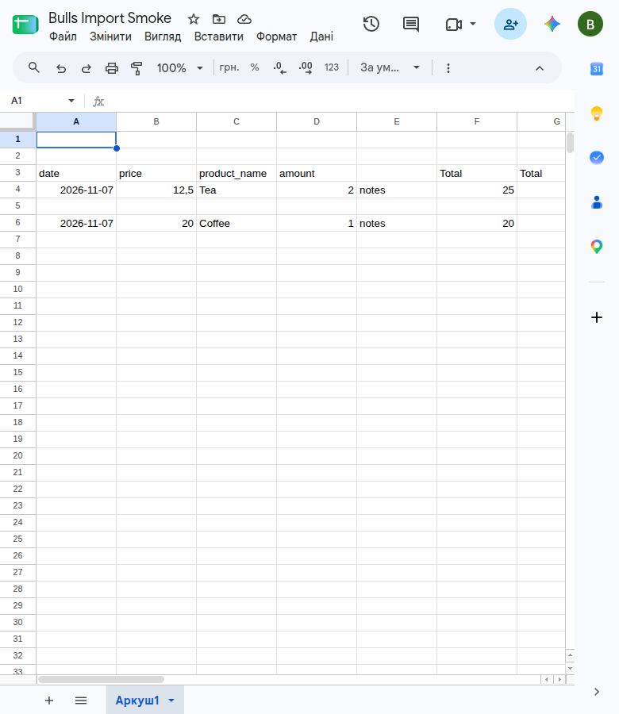

# Етап 8: тести та перевірка

Перевіряється погоджена модель: щоденні знімки, SHA-256, вставка чанками по 500
та атомарна заміна лише конкретного target/date. Бізнес-рядки з однаковими
значеннями дозволені; повторний імпорт не повинен множити рядки знімка.

## Матриця feature-тестів

Файл: `src/tests/Feature/Database/SheetImporterTest.php`.

| Вимога | Перевірка |
| --- | --- |
| Різний порядок колонок | `test_imports_reordered_physical_columns_and_ignores_unmapped_extras`: дві фізичні структури проходять справжній `SheetRowMapper`, потім імпортер і MySQL; перевіряються типізовані значення та source_row 4/6. |
| Додаткові колонки | Той самий тест: Notes, неіменована колонка та неоднозначний незмаплений Total не блокують імпорт і не створюють зайвих колонок у БД. |
| Авто-ALTER TABLE | `test_new_mapping_adds_physical_column_and_preserves_previous_day`: спочатку таблиця без price, потім новий mapping; колонка створюється й заповнюється, попередній день зберігається з NULL. |
| Одна вкладка → дві таблиці | `test_one_tab_populates_two_structures_and_repeat_does_not_duplicate_snapshots`: різні назви/набори колонок у двох таблицях; одне читання Google на групу вкладки. |
| Повтор без дублів | Той самий тест: scheduled повтор пропускається без читання Google; manual повтор замінює знімок. Два справжні однакові продажі лишаються двома рядками. |
| Атомарність | Існуючі тести помилкових значень та збою другого чанка перевіряють збереження попереднього знімка. |

## Незалежність автоматичних тестів від Google

Feature-тести імпортера підміняють `GoogleSheetsClient` через Mockery;
`Http::preventStrayRequests()` забороняє випадкові HTTP-запити. Нові сценарії
додатково перевіряють `Http::assertNothingSent()`. Тести самого Google-клієнта
використовують HTTP-fakes та згенерований тестовий RSA-ключ. Справжній JSON-ключ,
Google-таблиця та мережа для автоматичних тестів не потрібні.

MySQL-тести запускаються тільки на `mysql / bulls_testing`; перевірка безпеки
виконується до міграцій. DDL-тести використовують `DatabaseMigrations`, без
транзакційної обгортки `RefreshDatabase`.

## Відтворення в ізольованому MySQL 8.0

З кореня проєкту, за наявності Docker та встановлених PHP-залежностей у `src/vendor`:

```bash
docker compose -f docker-compose.mysql80-test.yml up -d --wait mysql
docker compose -f docker-compose.mysql80-test.yml run --rm -T --user "$(id -u):$(id -g)" php php artisan test
docker compose -f docker-compose.mysql80-test.yml run --rm -T --user "$(id -u):$(id -g)" php vendor/bin/phpunit -c phpunit.mysql.xml
```

Після перевірок видаляйте тільки цей одноразовий стек та його тестовий volume:

```bash
docker compose -f docker-compose.mysql80-test.yml down -v
```

Compose не публікує порт MySQL; основна `bulls` і VM не використовуються.
Не запускайте live-прогін одночасно з PHPUnit: його міграції очищають тестові дані.

## Ручна перевірка через UI

Використовуйте окрему тестову Google-таблицю з доступом Viewer для Service Account.
Ніколи не вставляйте JSON-ключ у форми чи репозиторій.

1. Залиште рядки 1–2 порожніми, заголовки розмістіть у рядку 3, дані — у 4 та 6.
   Додайте неіменовану колонку та два незмаплені заголовки Total.
2. Створіть source/tab із header_row=3 і два targets із різними цільовими таблицями
   та mappings. Запустіть імпорт і дочекайтеся succeeded обох targets.
3. Додайте mapping price → product_price типу decimal, запустіть повторно:
   нова фізична колонка має з’явитися й містити ціни, кількість рядків не зростає.
4. Переставте колонки Google-таблиці разом із заголовками та даними; повторіть
   імпорт і перевірте ті самі значення у відповідних цільових колонках.
5. Додайте mapping на Total: target має завершитися failed, успішний знімок
   залишається цілим. Приберіть mapping та деактивуйте тестову конфігурацію.

Автоматичні тести змінюють порядок на фікстурах. Додатково крок 4 виконано
на справжньому файлі через інтерфейс Google Sheets: колонку B переміщено праворуч
разом із заголовком і всіма даними. Сам клієнт імпортера зберігає readonly scope.

## Результат поточного прогону

Перевірено 2026-11-08 на `main`:

- Pint: змінений feature-файл відповідає стилю.
- Стандартний набір: **103 тести, 216 assertions**, усі успішні.
- Повний MySQL 8.0 suite: **191 тест, 794 assertions**, усі успішні
  (7 хв 10 с); чотири нові виконання включають дві фізичні структури колонок.
- Справжній Google Service Account прочитав тестову вкладку з header_row=3,
  порожніми початковими рядками, неіменованою колонкою та дублем Total.
- `SyncDispatcher` поставив одну database job на вкладку; справжній
  `queue:work --once` імпортував по два рядки у дві різні таблиці.
- Новий price mapping при наступному запуску додав та заповнив фізичну колонку;
  після повтору в обох таблицях лишилося по два рядки, source_row — 4/6.
- Окремий знімок попереднього дня збережено. Mapping на неоднозначний Total
  спричинив failed до DDL; попередні знімки залишилися незмінними.
- **Ручна перестановка підтверджена:** початковий порядок
  `date, product_name, price, amount` змінено на
  `date, price, product_name, amount`. Перед зміною збережено контрольний стан
  через API; після зміни повторне читання підтвердило незмінність усіх значень
  за заголовками й абсолютними номерами рядків. Імпорт через справжню database
  queue у MySQL після перестановки дав ті самі name/product_price/amount для
  кожного рядка контрольного стану. В обох таблицях лишилося по два рядки.

Живий прогін виконувався окремо від PHPUnit у тій самій одноразовій
`bulls_testing`, з таблицями `stage8_live_sales` / `stage8_live_products`.
Тестову конфігурацію деактивовано, після перевірки одноразовий стек і volume
видалено. У Google-файлі переставлено лише колонки product_name/price;
значення не змінено. Новий порядок залишено у файлі. Його ID, ключ і токени
не включено до звіту.

Скриншот справжнього файлу після перестановки (B3=price, C3=product_name):



Локальні журнали прогону: `/tmp/bulls-stage8-tests.log` та
`/tmp/bulls-stage8-live.log`, `/tmp/bulls-stage8-live-reordered.log`
(не додаються до Git).
